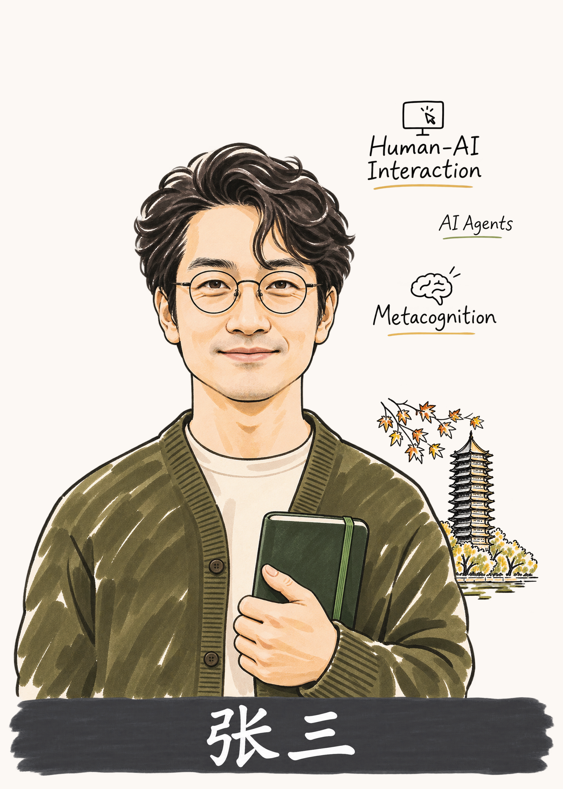

# 北大研究者手绘肖像

`$pku-scholar-portrait` 用于为研究者制作带北大校园元素的手绘肖像海报，适合学术活动嘉宾介绍、来访纪念和同风格系列画像。默认竖版 7 寸，人物与博雅塔或未名湖风景分层排版，可加姓名条和 2–3 个研究关键词。

## 使用

[下载 ZIP 安装包](https://github.com/Reimagica/pku-scholar-portrait/releases/latest/download/pku-scholar-portrait.zip)，解压后将完整 Skill 文件夹放到 `~/.codex/skills/pku-scholar-portrait/`。重新打开 Codex 会话，上传清晰的人物主照，然后输入 `$pku-scholar-portrait` 并说明需要保留的特征。生图需要会话具备图像生成能力。

1. 选 A 湖畔博雅塔、B 秋叶博雅塔或 C 未名湖石。未指定时按构图选用。
2. 提供姓名准确写法及 2–3 个关键词。缺少姓名时省略姓名条，关键词也可后补。
3. 查看人物、风景和关键词图层及拼接稿。补词、换景或改排版时可复用认可的人物层。

## 成品示例 · 张三

张三是虚构的 AI 研究者。示例使用[生成的参考照](examples/zhang-san-source.jpg)。

> 用 $pku-scholar-portrait 画这位 AI 研究者。姓名写“张三”，保留正面头部姿态、圆眼镜和手里的笔记本。选 B 秋叶博雅塔。研究关键词写 Human-AI Interaction、AI Agents、Metacognition。

制作流程见 [SKILL.md](SKILL.md)。
